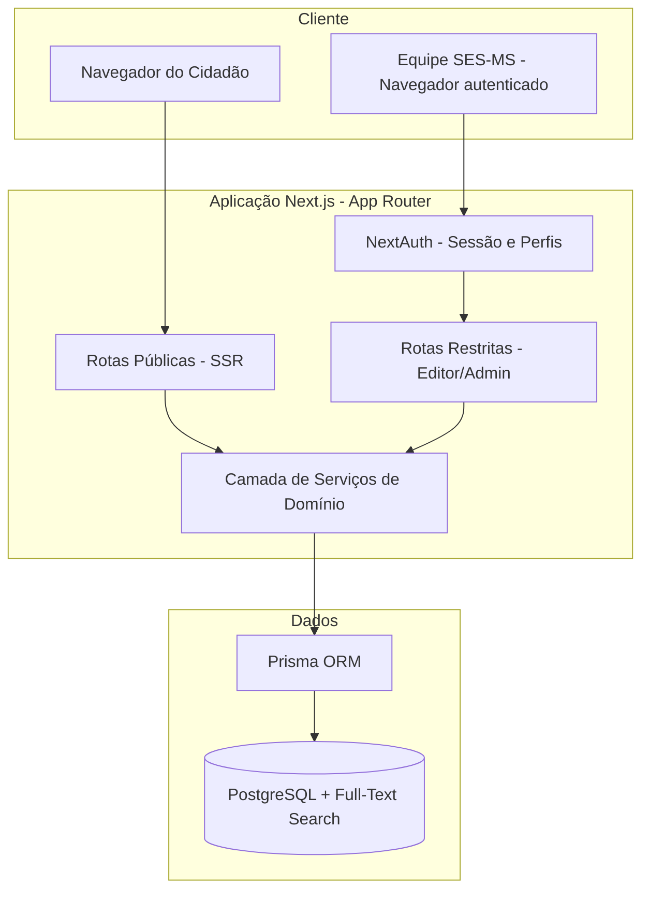
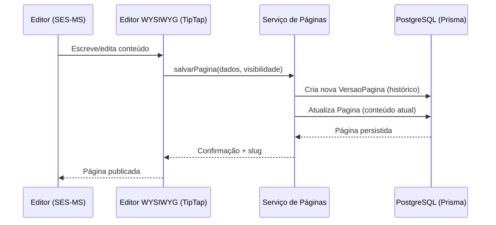
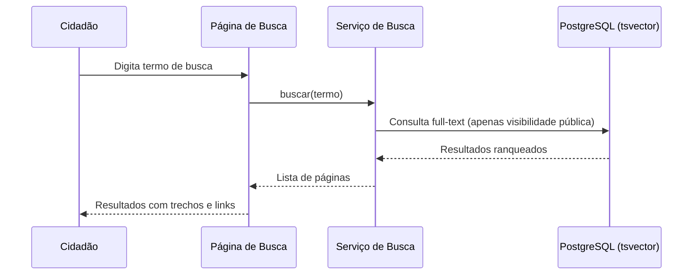

# Documento de Design: Wiki SES-MS (Base de Conhecimento)

## Visão Geral

O Wiki SES-MS é uma base de conhecimento navegável, inspirada no portal wiki da saúde do Espírito Santo (app.wiki.saude.es.gov.br), construída sob medida para a Secretaria de Estado de Saúde de Mato Grosso do Sul (SES-MS). O sistema permite que a equipe da SES-MS publique, organize e mantenha conteúdo institucional em páginas hierárquicas, ao mesmo tempo em que oferece à população acesso público a conteúdo selecionado.

O sistema é desenvolvido do zero (custom-built) usando Next.js (App Router, TypeScript), PostgreSQL via Prisma, autenticação com NextAuth e um editor visual WYSIWYG (TipTap) que salva conteúdo em markdown/HTML. A busca do MVP usa full-text search nativo do PostgreSQL. O conteúdo é organizado em uma árvore de categorias com duas dimensões: "áreas de atuação" da SES-MS e "temas" (como a RNDS).

Um objetivo central do MVP, além do wiki funcional, é entregar uma seção estruturada sobre a **RNDS (Rede Nacional de Dados em Saúde)** que documenta o que é a RNDS, o que é a federalização da RNDS e as etapas estaduais da federalização em MS ("onde estamos"). Como as etapas reais ainda não estão confirmadas, elas são modeladas como conteúdo editável (orientado a dados), permitindo preenchê-las posteriormente a partir do documento oficial de adesão da SES-MS/DATASUS.

### Contexto de domínio (background)

- **RNDS (Rede Nacional de Dados em Saúde):** plataforma nacional de interoperabilidade de dados em saúde do DATASUS, baseada no padrão HL7 FHIR e em terminologias como LOINC, SNOMED CT e CID.
- **Federalização da RNDS:** modelo no qual o estado opera sua própria instância federada da RNDS, integrada à base nacional, ganhando autonomia para integrar sistemas locais enquanto sincroniza com a base federal.

## Arquitetura

O sistema segue a arquitetura do Next.js App Router, com renderização no servidor para páginas públicas (bom para SEO e desempenho) e rotas protegidas para a área restrita. A camada de dados é isolada em serviços que acessam o PostgreSQL via Prisma.



### Fluxo de publicação de página (sequência)



### Fluxo de busca pública (sequência)



## Componentes e Interfaces

### Componente 1: Serviço de Autenticação e Perfis (Auth)

**Propósito:** Autenticar usuários da SES-MS e aplicar controle de acesso por perfil (admin, editor, leitor), separando conteúdo público de conteúdo restrito.

**Interface:**
```typescript
type Perfil = "admin" | "editor" | "leitor";

interface SessaoUsuario {
  id: string;
  nome: string;
  email: string;
  perfil: Perfil;
}

interface ServicoAuth {
  obterSessao(): Promise<SessaoUsuario | null>;
  possuiPermissao(sessao: SessaoUsuario | null, acao: Acao): boolean;
}

type Acao =
  | "ler_publico"
  | "ler_restrito"
  | "editar_pagina"
  | "gerenciar_categoria"
  | "gerenciar_usuario";
```

**Responsabilidades:**
- Integrar com NextAuth para login/logout e sessão.
- Resolver o perfil do usuário e autorizar ações.
- Bloquear acesso a conteúdo restrito para usuários não autenticados.

### Componente 2: Serviço de Categorias (árvore hierárquica)

**Propósito:** Gerenciar a árvore de categorias com duas dimensões (área e tema) e fornecer navegação hierárquica.

**Interface:**
```typescript
type TipoCategoria = "area" | "tema";

interface Categoria {
  id: string;
  nome: string;
  slug: string;
  tipo: TipoCategoria;
  categoriaPaiId: string | null;
  ordem: number;
}

interface NoArvore extends Categoria {
  filhos: NoArvore[];
}

interface ServicoCategorias {
  criar(dados: Omit<Categoria, "id">): Promise<Categoria>;
  atualizar(id: string, dados: Partial<Categoria>): Promise<Categoria>;
  remover(id: string): Promise<void>;
  obterArvore(tipo?: TipoCategoria): Promise<NoArvore[]>;
  obterCaminho(categoriaId: string): Promise<Categoria[]>; // breadcrumb
}
```

**Responsabilidades:**
- Manter integridade da hierarquia (sem ciclos).
- Fornecer a árvore para navegação e o caminho (breadcrumb) de uma categoria.

### Componente 3: Serviço de Páginas (conteúdo + versionamento)

**Propósito:** CRUD de páginas com editor WYSIWYG, controle de visibilidade e histórico de versões.

**Interface:**
```typescript
type Visibilidade = "publico" | "restrito";

interface Pagina {
  id: string;
  titulo: string;
  slug: string;
  conteudo: string;        // markdown/HTML gerado pelo TipTap
  visibilidade: Visibilidade;
  categoriaId: string;
  autorId: string;
  atualizadoEm: Date;
}

interface VersaoPagina {
  id: string;
  paginaId: string;
  titulo: string;
  conteudo: string;
  autorId: string;
  criadaEm: Date;
}

interface ServicoPaginas {
  criar(dados: Omit<Pagina, "id" | "atualizadoEm">): Promise<Pagina>;
  atualizar(id: string, dados: Partial<Pagina>): Promise<Pagina>; // cria VersaoPagina
  obterPorSlug(slug: string, sessao: SessaoUsuario | null): Promise<Pagina | null>;
  listarVersoes(paginaId: string): Promise<VersaoPagina[]>;
  restaurarVersao(paginaId: string, versaoId: string): Promise<Pagina>;
}
```

**Responsabilidades:**
- Persistir conteúdo e sempre registrar uma nova versão a cada atualização.
- Aplicar regra de visibilidade ao ler (páginas restritas só para autenticados).
- Restaurar versões anteriores criando uma nova versão (não destrutivo).

### Componente 4: Serviço de Busca (full-text PostgreSQL)

**Propósito:** Buscar páginas por termo, respeitando visibilidade.

**Interface:**
```typescript
interface ResultadoBusca {
  paginaId: string;
  titulo: string;
  slug: string;
  trecho: string;   // snippet destacado
  rank: number;
}

interface ServicoBusca {
  buscar(termo: string, sessao: SessaoUsuario | null): Promise<ResultadoBusca[]>;
}
```

**Responsabilidades:**
- Consultar índice `tsvector` do PostgreSQL.
- Filtrar por visibilidade conforme a sessão (anônimo vê só público).
- Ranquear e retornar trechos relevantes.

### Componente 5: Seção RNDS e Etapas de Federalização

**Propósito:** Apresentar conteúdo explicativo sobre a RNDS e sua federalização, além das etapas estaduais editáveis com ordem e status ("onde estamos").

**Interface:**
```typescript
type StatusEtapa = "nao_iniciada" | "em_andamento" | "concluida";

interface EtapaFederalizacao {
  id: string;
  nome: string;
  ordem: number;
  status: StatusEtapa;
  descricao: string;
}

interface ServicoRnds {
  listarEtapas(): Promise<EtapaFederalizacao[]>;       // ordenadas por `ordem`
  criarEtapa(dados: Omit<EtapaFederalizacao, "id">): Promise<EtapaFederalizacao>;
  atualizarEtapa(id: string, dados: Partial<EtapaFederalizacao>): Promise<EtapaFederalizacao>;
  removerEtapa(id: string): Promise<void>;
}
```

**Responsabilidades:**
- Fornecer etapas ordenadas e seu status atual.
- Permitir gestão das etapas por editores/admins (dados, não hardcode).

## Modelos de Dados

### Modelo: Usuario

```typescript
interface Usuario {
  id: string;
  nome: string;
  email: string;      // único
  senhaHash: string;
  perfil: Perfil;     // "admin" | "editor" | "leitor"
  criadoEm: Date;
}
```

**Regras de validação:**
- `email` deve ser único e em formato válido.
- `perfil` deve ser um dos valores permitidos.

### Modelo: Categoria

```typescript
interface Categoria {
  id: string;
  nome: string;
  slug: string;              // único
  tipo: TipoCategoria;       // "area" | "tema"
  categoriaPaiId: string | null;
  ordem: number;
}
```

**Regras de validação:**
- `slug` único e derivado de `nome`.
- `categoriaPaiId` não pode gerar ciclo na árvore.
- `tipo` de um filho deve ser coerente com o da raiz da sua sub-árvore.

### Modelo: Pagina

```typescript
interface Pagina {
  id: string;
  titulo: string;
  slug: string;              // único
  conteudo: string;
  visibilidade: Visibilidade; // "publico" | "restrito"
  categoriaId: string;
  autorId: string;
  atualizadoEm: Date;
}
```

**Regras de validação:**
- `titulo` não vazio.
- `slug` único.
- `categoriaId` deve referenciar categoria existente.
- `visibilidade` deve ser um valor permitido.

### Modelo: VersaoPagina

```typescript
interface VersaoPagina {
  id: string;
  paginaId: string;
  titulo: string;
  conteudo: string;
  autorId: string;
  criadaEm: Date;
}
```

**Regras de validação:**
- Toda atualização de `Pagina` gera exatamente uma `VersaoPagina`.
- Versões são imutáveis após criação.

### Modelo: EtapaFederalizacao

```typescript
interface EtapaFederalizacao {
  id: string;
  nome: string;
  ordem: number;              // define sequência
  status: StatusEtapa;        // "nao_iniciada" | "em_andamento" | "concluida"
  descricao: string;
}
```

**Regras de validação:**
- `ordem` é inteiro; a lista exibida é ordenada por `ordem`.
- `status` deve ser um valor permitido.

## Correctness Properties

*A property is a characteristic or behavior that should hold true across all valid executions of a system-essentially, a formal statement about what the system should do. Properties serve as the bridge between human-readable specifications and machine-verifiable correctness guarantees.*

### Property 1: Isolamento de conteúdo restrito

*Para toda* consulta de página, busca ou navegação feita por um usuário não autenticado (sessão nula), nenhum resultado retornado deve ter `visibilidade = "restrito"`.

**Validates: Requirements 2.1, 2.2, 6.4, 7.3**

### Property 2: Round-trip de slug

*Para toda* categoria ou página, gerar o slug a partir do nome/título e depois resolver a entidade pelo slug deve retornar a mesma entidade, e o slug deve ser único.

**Validates: Requirements 3.1, 4.1**

### Property 3: Ausência de ciclos na árvore de categorias

*Para toda* operação de criação ou reparentamento de categoria, a estrutura resultante deve permanecer acíclica (nenhuma categoria é ancestral de si mesma).

**Validates: Requirements 3.3**

### Property 4: Reconstrução consistente da árvore e do caminho

*Para todo* conjunto de categorias, a árvore retornada deve refletir todas as relações pai/filho, e o caminho (breadcrumb) de qualquer categoria deve conter a própria categoria e terminar em uma raiz.

**Validates: Requirements 3.4, 3.5, 7.2**

### Property 5: Versionamento preserva histórico

*Para toda* sequência de N atualizações de uma página, o número de versões registradas deve aumentar em exatamente N, e cada versão anterior deve permanecer inalterada.

**Validates: Requirements 5.1, 5.2**

### Property 6: Ordenação cronológica do histórico

*Para toda* página, a listagem de versões deve estar ordenada cronologicamente por data de criação.

**Validates: Requirements 5.3**

### Property 7: Restauração é não destrutiva

*Para toda* página e versão histórica escolhida, restaurar aquela versão deve produzir conteúdo igual ao da versão escolhida e criar uma nova versão, sem apagar versões existentes.

**Validates: Requirements 5.4**

### Property 8: Autorização coerente com o perfil

*Para toda* combinação de perfil e ação, a decisão de autorização deve ser consistente com a matriz de permissões definida (uma ação é permitida se e somente se o perfil a possui).

**Validates: Requirements 1.4**

### Property 9: Senha nunca persistida em texto claro

*Para toda* senha informada, o valor persistido do usuário nunca deve ser igual à senha em texto puro.

**Validates: Requirements 1.5**

### Property 10: Sanitização de HTML

*Para todo* conteúdo HTML de entrada, a saída sanitizada não deve conter tags ou atributos executáveis (scripts) perigosos.

**Validates: Requirements 4.5**

### Property 11: Conteúdo completo dos resultados de busca

*Para todo* resultado de busca retornado, o resultado deve conter título, slug e um trecho do conteúdo, e a lista deve estar ordenada por relevância (rank) decrescente.

**Validates: Requirements 6.1, 6.2**

### Property 12: Ordenação das etapas de federalização

*Para todo* conjunto de etapas de federalização, a listagem deve estar ordenada de forma crescente por `ordem`.

**Validates: Requirements 8.3**

## Tratamento de Erros

### Cenário 1: Acesso não autorizado a conteúdo restrito

**Condição:** Usuário anônimo tenta acessar página restrita ou rota da área restrita.
**Resposta:** Redirecionar para login (ou retornar 404 para não revelar existência, conforme política).
**Recuperação:** Após login com perfil adequado, o acesso é concedido.

### Cenário 2: Slug duplicado

**Condição:** Criação de página/categoria com slug já existente.
**Resposta:** Rejeitar a operação e retornar mensagem descritiva; sugerir slug alternativo.
**Recuperação:** Usuário ajusta o título/slug.

### Cenário 3: Categoria inexistente ao criar página

**Condição:** `categoriaId` não referencia categoria válida.
**Resposta:** Rejeitar com erro de validação.
**Recuperação:** Usuário seleciona categoria existente.

### Cenário 4: Ciclo na hierarquia de categorias

**Condição:** Reparentamento cria ciclo.
**Resposta:** Rejeitar a operação com erro descritivo.
**Recuperação:** Usuário escolhe outro pai válido.

## Estratégia de Testes

### Abordagem de Testes Unitários

Cobrir geração de slug, regras de validação, autorização por perfil e a lógica de versionamento com exemplos e casos de borda (títulos vazios, slugs duplicados, perfis sem permissão).

### Abordagem de Testes Baseados em Propriedades

Validar as propriedades universais definidas na seção Correctness Properties: isolamento de conteúdo restrito, round-trip de slug, ausência de ciclos, integridade do versionamento, restauração não destrutiva e ordenação de etapas.

**Property Test Library:** fast-check (TypeScript).

### Abordagem de Testes de Integração

Testar fluxos end-to-end com banco de testes: publicação de página, busca full-text respeitando visibilidade, e navegação por breadcrumb. Verificar login/perfis via NextAuth em rotas protegidas.

## Considerações de Segurança

- Senhas armazenadas com hash forte (ex.: bcrypt/argon2).
- Sanitização do HTML gerado pelo TipTap para evitar XSS.
- Controle de acesso aplicado no servidor (não confiar apenas na UI).
- Sessões gerenciadas pelo NextAuth com cookies seguros.

## Considerações de Desempenho

- Renderização no servidor (SSR) para páginas públicas e cache quando aplicável.
- Índice `tsvector` no PostgreSQL para busca eficiente.
- Paginação de resultados de busca e listagens.

## Dependências

- Next.js (App Router) + TypeScript
- PostgreSQL + Prisma ORM
- NextAuth (autenticação e sessão)
- TipTap (editor WYSIWYG)
- fast-check (testes de propriedade)
